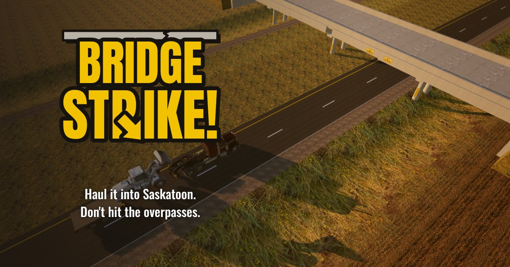

# BRIDGE STRIKE!

A browser driving sim about hauling oversized loads into Saskatoon without hitting the
overpasses. Based on the real 2026 Saskatoon bridge strikes. Real place names; every
company, driver and newscast is made up.



## Play

- **Desktop**: W / S gas and brake, A / D steer, hold SPACE to lower the deck 30 cm,
  J jake brake, C camera (chase / cockpit / drone), T time of day, M mute, R restart.
- **Phone**: steering wheel bottom-left, pedals bottom-right, LOWER LOAD, CAM, JAKE.

Read the yellow clearance plate over each lane: if your load fits, stay; if it fits
lowered, hold LOWER; if it doesn't fit even lowered, change lanes.

## Run it

```
npm install
npm run dev          # Next.js app at http://localhost:3000
npm run build:sim    # single-file build: dist/sim.html (everything embedded)
npm run test:sim     # Playwright checks: bots deliver every load, strikes, phones
npm run media:trailer  # renders media/trailer.mp4 and public/og.jpg
```

Deploying to Vercel: [docs/DEPLOY.md](docs/DEPLOY.md). Music: [docs/MUSIC.md](docs/MUSIC.md).
Assets pipeline: [assets/README.md](assets/README.md). Plan, research, milestone notes:
[docs/PLAN.md](docs/PLAN.md).

## Stack

Next.js (App Router), TypeScript, Tailwind, Three.js (post stack: bloom, grade, ACES),
Rapier physics (ray-cast vehicles joined by a kingpin), Web Audio (procedural engine and
crash sounds). Models are generated with fal (Nano Banana Pro concepts → Hunyuan3D), then
cleaned up by the import pipeline in `scripts/assets/`.
